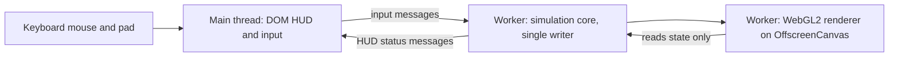

# ADR 0002: Adopt the Axiom tech stack, layer by layer

- **Status:** Proposed
- **Date:** 2026-11-08
- **Deciders:** repository owner

## Context

Axiom is a deterministic 2D factory simulation that must run at 60 UPS and 60 FPS on integrated
graphics, in a browser with zero install, and on Steam for Windows, macOS, Linux and the Steam Deck.
This ADR tests each layer of the current stack against the requirements below. It does not defend the
current choices. For each layer it records the options, the decision, the reason, and what would
change the decision. The follow-up issues at the end point at existing roadmap issues where they exist.

### Requirements used as tests

| ID | Requirement | Source |
|---|---|---|
| R1 | Fixed 60 Hz tick, integer simulation state, no floating point in state | [rust-wasm spec](../../specs/axiom-master-prompt-rust-wasm.md) section 1.2 |
| R2 | 60 UPS and 60 FPS on integrated graphics; no compute shaders or heavy GPU passes | rust-wasm spec 1.1, 2.4 |
| R3 | 60 UPS with 200,000 active belt items; 50,000-tick determinism with a BLAKE3 state hash; at most 256 MB heap after 10 hours | [studio spec](../../specs/axiom-master-prompt-studio.md) section V |
| R4 | Zero-install play on Chrome, Edge, Safari and Firefox; load to play in 3.5 s or less; WASM at most 8 MB compressed | studio spec section V |
| R5 | COOP and COEP headers for SharedArrayBuffer, with a logged single-threaded fallback | rust-wasm spec 3.1, 3.2 |
| R6 | Steam release on Windows, macOS, Linux and Steam Deck | owner request, [ADR-0001 desktop shell](../../../projects/axiom/desktop/ADR-0001-desktop-shell.md) |
| R7 | Reproducible builds; line and function coverage at least 90%, region coverage at least 85%; zero clippy warnings; `wasm-bindgen-test` in headless browsers; a Criterion stress benchmark | owner request, rust-wasm spec section 4, [quality gates](../quality-gates.md) |
| R8 | SOLID, domain-driven design, TDD, readable code | [engineering principles](../engineering-principles.md) |

### Facts checked

**In the repository (read on 2026-11-08):**

- `projects/axiom` has 2,142 lines of Rust in `src/` (including `lib.rs`). `Cargo.toml` has no
  `[dependencies]` section. `Cargo.lock` is tracked.
- `cargo test --all-targets` passes 47 unit tests on x86_64 Linux with stable rustc 1.97.0.
  `cargo clippy --all-targets --all-features -- -D warnings` passes on a fresh check.
- The seven `#[no_mangle] extern "C"` exports in `src/wasm.rs` are not called by any test. The native
  tests cover only the helper functions. No JavaScript type describes the exports.
- WASM is built three different ways. `ci.yml` (job `wasm`) and `steam-build.yml` build on stable,
  without atomics or threads. `release.yml` installs nightly with `rust-src`, which enables threads,
  and does not pin the nightly date. `scripts/build-wasm.sh` chooses the path by what is installed.
- Toolchains and tools float. CI uses `dtolnay/rust-toolchain@stable`, `taiki-e/install-action` with no
  version, and cargo commands without `--locked`. There is no `rust-toolchain.toml`.
- `desktop/package.json` pins `electron` at `^40.0.0`, `electron-builder` at `^26.15.6`, and sets
  `packageManager` to `bun@1.4.4`.
- `docs/site/build.py` is a standard-library Python builder that checks links, anchors and Mermaid
  keywords. It is not Jekyll, and `docs/site/_config.yml` says so. The README it cites does not exist.
- `projects/axiom/docs/ARCHITECTURE.md` is stale. It says rear insertion is O(N) and that splitters and
  inserters are not started. `src/simulation/belt.rs` is a ring buffer, and `splitter.rs` and
  `inserter.rs` exist. Roadmap issue #6 tracks this.
- Two documents are numbered ADR-0001: `docs/engineering/adr/0001-monorepo-layout.md` and
  `projects/axiom/desktop/ADR-0001-desktop-shell.md`.

**External (checked on 2026-11-08 by search and fetch):**

- Electron 45 is the latest major and bundles Chromium M156. Electron 44 is supported until
  2027-03-02 and Electron 43 until 2027-01-05 ([endoflife.date](https://endoflife.date/electron)).
  Electron 40 is not in the list of supported majors.
- WebGPU ships in Chrome and Edge on Windows, macOS and ChromeOS, in Firefox 141 on Windows, in Firefox
  145 on Apple Silicon Macs running macOS Tahoe, and in Safari 26. Both Chrome and Firefox list Linux
  support as "in progress" ([web.dev](https://web.dev/blog/webgpu-supported-major-browsers)).
- Steam Linux Runtime 4.0 moves its base to Debian 13.2 and removes GTK and Qt. The article does not
  mention WebKitGTK ([GamingOnLinux](https://www.gamingonlinux.com/2025/11/valve-put-up-a-new-steam-linux-runtime-4-0-with-a-move-towards-64-bit)).
- Tauri 2 uses `webkit2gtk-4.1` on Linux ([Tauri blog](https://v2.tauri.app/blog/tauri-2-0-0-alpha-3/)).
- `cargo -Z build-std` is rejected on the stable channel. Threaded WASM still needs nightly.

**Not verified in this environment:**

- crates.io is not reachable from this sandbox (DNS fails for `index.crates.io`), so no crate version
  below is checked. Versions are marked "verify".
- The `wasm32-unknown-unknown` target is not installed here, and `static.rust-lang.org` is blocked by
  policy. The WASM build, its size, and the wasm-bindgen CLI were not run.
- `cargo-llvm-cov`, `cargo-deny`, `cargo-nextest` and `cargo-mutants` are not installed. The coverage
  and supply-chain gates were not run here.
- No Steam Deck, Safari, Firefox or Electron build was available.

**Measured in this sandbox.** The machine is a 2-vCPU Intel Xeon at 2.10 GHz. It is not the target
hardware. Command: `cargo bench --bench belt_throughput` (full sizes, release profile).

| Scenario | Size | Median time per tick |
|---|---|---|
| `stress_100k_items_10k_segments` | 10,000 lanes, 100,000 items, 1,000 ticks | 238,229 ns |
| `blocked_backpressure` | same layout, sink closed | 299,620 ns |
| `rear_push` | one push, advance and pop per tick, 1,000,000 cycles | 366 ns |

At 60 UPS one tick has a budget of 16,667 microseconds. The stress scenario uses about 1.4% of it on
this machine. The quick-mode run is smaller and is not comparable. A test-profile run of the same full
benchmark was about 10 times slower, so debug timings are not used anywhere in this ADR.

The full-size state hashes are identical in the debug (test) profile and the release profile for all
three scenarios (`0x89253f537cf8d2f3`, `0x179bd004c376e06a`, `0x3a569a910ca391a3`). This covers x86_64
Linux only. It has not been checked on wasm32 or on Windows and macOS.

## Decision

We will keep Rust for the simulation. We will move the JavaScript boundary from the hand-written C ABI
to wasm-bindgen, and run the simulation single-threaded in one dedicated Web Worker that also owns the
WebGL2 renderer. We will use TypeScript built with Bun as the browser shell, and keep Electron as the
Steam host, pinned to a supported major.

| Layer | Decision | Status |
|---|---|---|
| 1. Simulation language | Rust. Pin the toolchain. Move to edition 2024 after pinning | Kept |
| 2. WASM bridge | wasm-bindgen in a bridge module that compiles only for wasm32 | Changed |
| 3. Threading | One worker, single-threaded. SharedArrayBuffer and worker pools deferred | Changed (defaults), threads deferred |
| 4. Rendering | WebGL2 instanced sprites on OffscreenCanvas. WebGPU deferred | Kept (planned) |
| 5. Browser shell | TypeScript, bundled with Bun, no UI framework, `tsc` in CI | Changed |
| 6. Desktop and Steam | Electron, moved from `^40` to a supported major (45). Deck spike required | Kept, upgrade required |
| 7. Testing and quality | Keep `cargo test`. Add proptest, cargo-mutants (nightly), BLAKE3 digest. Criterion after #4 | Mixed |
| 8. Build and CI | Pin toolchain and tools, add `--locked`, reproducibility and size checks | Changed |
| 9. Save files | Policy: hand-written versioned binary with a BLAKE3 digest. No serde on state | Decided, deferred |
| 10. Docs | Markdown, Mermaid rendered by GitHub, existing `build.py`. No mdBook yet | Kept |

### 1. Simulation language

**Options.**

- Rust, current. Integer semantics are defined, the type system separates identifiers, and the WASM and
  test tooling are first class.
- C++ (17 or 20). The same speed, but memory and undefined-behaviour safety are on the team, not the
  compiler. Identifier newtypes are possible but not enforced.
- Zig. Good low-level control. Verify its stability status before any adoption decision.
- A garbage-collected runtime (.NET, Go, AssemblyScript on a GC). Collector pauses hurt frame pacing.

**Decision.** Keep Rust.

**Reasons.**

- The determinism argument needs to be stated precisely. A garbage collector cannot change integer
  results, so GC is not what breaks determinism. The real arguments are frame pacing and memory control.
  The tick path must not pause or allocate, and Rust makes that explicit: capacity is reserved and
  `Vec` growth is visible in review.
- The simulation is not the performance risk. The stress scenario uses about 1.4% of the tick budget on
  this machine (see Facts checked). The render path and the JavaScript boundary are the risks, and
  neither is measured yet.
- The ecosystem covers the other requirements: `cargo test`, `wasm-bindgen`, `wasm-bindgen-test`,
  `proptest`, `cargo-mutants` and Criterion.

**Two rules that must be enforced.**

- Integer overflow panics in debug builds and wraps in release builds by default. A simulation that
  overflows would hash differently between profiles with no error in release. Every overflow that is
  meant must be written as `wrapping_`, `checked_` or `saturating_`. The existing debug and release
  hashes agree on this machine, which is evidence and not proof.
- Data layout uses explicit structs in typed `Vec` pools, not an ECS crate. The spec lists `hecs` as an
  option. An ECS query order depends on archetype layout, which is harder to review for determinism than
  an explicit index order. The spec's `fixed` crate is not adopted, because discrete integer units were
  chosen (ARCHITECTURE gap 3). `bytemuck` and `parking_lot` are not adopted until a renderer or threads
  need them. SIMD128 is deferred until a profile shows that the scalar path is the limit.

**What would change this.** A measured tick budget failure on the target hardware that scalar Rust
cannot fix. That would be a reason to optimise code, not to change language.

**Follow-ups.**

- Pin the toolchain: add `rust-toolchain.toml` and `rust-version` to `Cargo.toml`. Acceptance: CI uses
  the pinned version, and no CI step uses a floating `stable`.
- Move to edition 2024. Acceptance: fmt, clippy with `-D warnings` and all tests pass, and the 1,000-tick
  hash does not change.
- Overflow audit. Acceptance: every integer operation in `src/simulation` that can overflow is explicit,
  and the determinism scenario gives the same hash in debug and release.

### 2. WASM bridge

**Current state.** Seven `extern "C"` functions in `src/wasm.rs` (236 lines). Arguments and results are
`u32`. The 64-bit state hash is split into `axiom_state_hash_lo` and `axiom_state_hash_hi`. The world
lives in a `thread_local!` `RefCell`. The JavaScript side matches names by convention, and no test calls
an export.

**Options.**

- A. Keep the hand-written C ABI. No dependencies and full control. The contract is checked only at run
  time, there are no types for JavaScript, and each new Web API call adds hand-written glue.
- B. wasm-bindgen with a pinned wasm-bindgen-cli. It generates JavaScript glue and `.d.ts` types, maps
  `u64` to `BigInt`, turns slices and vectors into typed arrays, and turns errors into exceptions.
- C. The WebAssembly component model (wit-bindgen with jco). Browsers run core WASM, so this needs a
  transpile step. It is too heavy for this surface.
- D. A raw ABI with a `.d.ts` generated from a hand-maintained contract. Partial type safety and a custom
  tool to keep working.

**Decision.** B. Put the bridge in its own module, compiled only for `wasm32` and depending on
`wasm-bindgen` through a target-specific dependency. The simulation core keeps no dependencies, and
native `cargo test` never compiles the bridge.

**Reasons.**

- The studio spec requires WebAudio through WASM bindings (section III.3), and the rust-wasm spec requires
  `wasm-bindgen-test` (section 4.2). Both assume `wasm-bindgen` and `web-sys`. Hand-written glue would grow
  with every Web API call.
- Generated TypeScript declarations remove a class of errors where Rust and JavaScript drift apart. This
  matters more once the shell is TypeScript (layer 5).
- A `u64` digest becomes a `BigInt` or a 32-byte `Uint8Array`, which removes the lo and hi split.
- ABI stability is not a reason to keep the C ABI. There is no external consumer. The only consumer is
  `web/`, which lives in this repository and will be built and checked with it.
- Zero-copy reads of the instance buffer cost the same either way. Both approaches return a pointer and a
  length, and JavaScript builds a `Uint32Array` view on `memory.buffer`. Any `memory.grow` detaches those
  views, so memory must be sized up front (rust-wasm spec 3.3). This is a constraint in both designs.

**Costs we accept.** A new dependency, a version pin between the `wasm-bindgen` crate and the CLI, a
generated JavaScript file, and one more CI install. The threading path is unchanged: threads still need
nightly and `build-std` with either design.

**What would change this.**

- The CLI cannot be pinned reproducibly in CI. Then fall back to the raw ABI with a generated `.d.ts`.
- Compressed size goes past the 8 MB budget because of the glue or `web-sys`. Measure first. The budget
  is far above the current code size, so this is unlikely.
- A future threaded build needs a memory layout that the shared-memory glue cannot express. Verify when
  threads are attempted.

**Follow-ups.**

- Replace the C ABI with the wasm-bindgen bridge (new issue, after #12). Acceptance: `web/` calls typed
  exports, `axiom_state_hash_lo` and `_hi` are removed, and the digest is returned as a 32-byte array.
- #12 headless browser test. Acceptance: `wasm-bindgen-test` runs the bridge in headless Chromium in CI,
  with the runner version equal to the crate version in `Cargo.lock`.
- Pin the CLI (new issue). Acceptance: `build-wasm.sh` fails if the installed `wasm-bindgen` CLI version
  differs from `Cargo.lock`.

### 3. Threading model

**Options.**

- A. Single thread. Simulation and rendering on the main thread.
- B. One dedicated worker that owns the simulation and renders through OffscreenCanvas. The main thread
  owns the DOM, input and HUD. No shared memory.
- C. B, plus SharedArrayBuffer and Atomics for handoff between threads (double-buffered frame state).
- D. A parallel tick across a worker pool (`wasm-bindgen-rayon` or equivalent), with chains partitioned
  across threads.

**Evidence.**

- The stress scenario takes about 0.24 ms per tick on this machine. The studio spec's largest load is
  200,000 active items, about twice the stress scenario. Linear scaling would give about 0.5 ms per tick.
  That is a projection, not a measurement. The budget is 16.7 ms.
- Parallel ticks would make cross-chain order a concurrency problem. ARCHITECTURE gap 5 already says that
  cross-chain interactions need a fixed order. A parallel tick would have to produce the same hash as a
  serial tick. That cost is large, and no measured need justifies it.
- COOP and COEP are needed only for SharedArrayBuffer. GitHub Pages does not let a project set response
  headers (verify against the current Pages documentation). So a browser build hosted there cannot use
  SharedArrayBuffer without a service-worker workaround. A single-threaded build runs anywhere, which
  satisfies R4.
- The rust-wasm spec (3.2) asks for a single-threaded fallback. Option B makes that path the default.

**Decision.** B. The worker is the single writer of simulation state, and the renderer reads state the
worker owns. No locks are needed. C is deferred until a measured trigger. D is rejected for now.

**Build consequence.** `scripts/build-wasm.sh` currently prefers nightly threads when nightly is installed.
CI and the Steam build therefore produce a non-threaded artifact, and the release job produces a threaded
one with a different SIMD flag set. Make the single-threaded build the default for every job, and require
an explicit flag (for example `AXIOM_THREADS=1`) for the threaded build.

**What would change this.**

- A stress tick above half of the 16.7 ms budget on the Steam Deck. This threshold is a proposal, not a
  measurement.
- Input latency above the 16.6 ms requirement (R4) that is caused by simulation work on the worker. Then
  the simulation may need its own thread, using option C.
- A second heavy system (pathfinding, for example) that can run beside the simulation without sharing
  mutable state.

**Follow-ups.**

- Make one WASM build flag set for CI, release and Steam (new issue). Acceptance: the three WASM jobs run
  the same `build-wasm.sh` path, and the script prints the flags it used.
- #14 Run the simulation in the Web Worker. Acceptance: the worker is the only writer of simulation state.
  The main thread receives only HUD messages.
- Record the Deck stress tick in #3. Acceptance: the number is in the issue with the hardware named.

### 4. Rendering

**Options.**

- A. Canvas2D sprite batching with one `drawImage` call per sprite.
- B. WebGL2 instanced sprites. One draw call per texture atlas, with per-instance attributes
  (`pos_x`, `pos_y`, `tile_id`, `rotation`) from a buffer.
- C. WebGPU.
- D. wgpu, for both native and browser builds. It uses a WebGL2 or WebGPU backend in the browser.
- E. A rendering library such as PixiJS or three.js.

**Evidence.** WebGPU is not available on Linux in Chrome or Firefox yet. The Steam Deck is Linux, and
Electron on Linux uses Chromium, so WebGPU is not available there either. WebGL2 ships in all four
browsers named in R4, and in Chromium on Linux (verify the per-browser versions in the test matrix).

**Decision.** B. Run the WebGL2 instanced sprite renderer in the simulation worker through OffscreenCanvas.
Fall back to a main-thread canvas only where OffscreenCanvas lacks WebGL2 (verify per browser). This
matches roadmap #13.

**Reasons.**

- The spec requires it (rust-wasm 1.4 and 2.4, and the no-compute-shaders rule in 1.1). The workload is
  one or two draw calls per frame plus a per-frame instance upload.
- The cost is controlled by the number of visible instances. The 32 by 32 chunk grid with sleep and wake
  decides what is drawn and uploaded. Dirty-chunk tracking keeps uploads small.
- Canvas2D rasterises on the CPU and pays per sprite. It is the first fallback if WebGL2 is missing, not
  the main path.
- wgpu is the right tool for a native desktop renderer (layer 6). In the browser it adds size and a second
  renderer to certify, so it is not the zero-install path now.
- A rendering library adds a scene graph, which is a second model of game state. The domain rule says the
  renderer reads state and never writes it, so a scene graph conflicts with that rule.

**What would change this.**

- WebGPU ships on Linux in Chrome and Firefox. Then add it as an optional backend behind feature detection.
  WebGL2 stays the baseline.
- The Deck measurement misses 60 FPS with WebGL2 after culling and dirty-chunk upload. Then evaluate wgpu
  on the native path first.
- The number of visible sprites is larger than culling can reduce. Then revisit the data model.

**Follow-ups.**

- #13 Instanced WebGL2 renderer. Acceptance: one draw call per atlas page, uploads only for dirty chunks, and
  frame time recorded at 1280x800 on the Deck and on an Intel integrated GPU.
- Memory views (part of #13). Acceptance: the renderer recreates typed-array views after `memory.grow`, and
  a test shows the stress scenario never grows memory during play.

### 5. Browser shell and language

**Options.**

- A. Plain JavaScript, untyped, current `web/`.
- B. TypeScript, bundled with Bun, no UI framework, `tsc --noEmit` in CI.
- C. TypeScript with a UI framework (React, Svelte, Solid, Preact or Lit).
- D. A Rust UI (Leptos, Dioxus or egui) on `web-sys`.

**Decision.** B. Bun is the package manager, test runner and bundler for the tooling. It is not shipped to
players. Its output is static ES modules and `axiom.wasm`. Bun does not type-check, so `tsc --noEmit` runs
in CI (the migration owner should wire it).

**Reasons.**

- The boundary is the riskiest seam. The generated `.d.ts` from layer 2 is checked on every change.
- The shell draws to a canvas, forwards input, handles resize and shows a HUD. The simulation owns state.
  A framework adds a second state model in the browser, which the domain rule forbids.
- Bun is already in use (`packageManager` in `desktop/package.json`, and the owner says it is being
  migrated). Consistency is worth more than a new tool.
- A Rust UI would move HUD work into a WASM UI framework with a small ecosystem and a larger binary. That
  cuts against R4.
- Electron keeps its own Node runtime. Bun drives only the build. Whether `electron-builder` runs under Bun
  is unverified and belongs to the migration.

**Lint and format.** Biome is a candidate: a single Rust-native binary that works with Bun (verify). Decide
it together with the migration, not in this ADR.

**What would change this.**

- The HUD grows into many stateful screens (inventory, blueprints, settings, tutorials) and the DOM code
  becomes hard to reason about. Then add a small view library for the HUD only. Preact or Lit fits, with
  the size checked first (verify). Where this line falls is a judgement, not a measurement.
- Bun breaks the Electron build in a way that cannot be fixed. Then run that build with Node.

**Follow-ups.**

- Type-check `web/` in CI (after the migration). Acceptance: `tsc --noEmit` passes in CI and fails on a
  deliberate type error.
- Generated types only (after layer 2). Acceptance: `web/` imports the generated bridge types, and no
  hand-written copy of an export signature remains.

### 6. Desktop and Steam shell

**Re-verification of ADR-0001 (desktop shell).**

| ADR-0001 claim | Status now |
|---|---|
| Tauri on Linux needs a system WebKitGTK | Confirmed. Tauri 2 uses `webkit2gtk-4.1` |
| SteamOS or the Steam Linux Runtime may not provide WebKitGTK | Partly confirmed. Steam Linux Runtime 4.0 removes GTK and does not mention WebKitGTK. WebKitGTK depends on GTK, so it is very likely absent. Verify against Valve's runtime package list |
| Electron pins one Chromium per release | Confirmed. Electron 45 bundles Chromium M156 |
| Gamepad API behaviour depends on the WebKitGTK build | Not verified. Verify on the Deck |
| Each Electron major must be upgraded within its support window | Confirmed, and urgent. The repo pins `^40.0.0`, which is not in the supported list |
| Chromium's sandbox needs user namespaces or a setuid helper, and a depot cannot set the setuid bit | Not verified. Verify on the Deck |
| Electron output is large | Not measured. Measure the depot size |

**Options.**

- A. Electron (ADR-0001). Chromium is bundled, so every OS runs the same engine. It needs a Node toolchain.
- B. Tauri 2. The system webview is used: WebKitGTK on Linux, WKWebView on macOS, and WebView2 on Windows.
  The shell is smaller and written in Rust.
- C. A native Rust shell. A `winit` window, a `wgpu` renderer (Vulkan on the Deck), gamepad input through a
  crate such as `gilrs` (verify), and Steamworks through a Rust binding (verify). No browser engine. The
  browser build still ships for zero-install play.
- D. A Proton-only Windows build. Not a separate option, because the Windows depot already runs through
  Proton on the Deck.

**Decision.** A. Keep ADR-0001 and move the pin to a supported major (roadmap #20). Do not adopt B for
v0.3.0. Keep C as the named fallback if the Deck spike fails.

**Reasons.**

- The Deck is the one target that CI cannot test. Electron has one engine, so one Deck test covers the
  engine on every platform. Tauri has three engines, each with its own gamepad, WebGL2 and COOP and COEP
  behaviour. The Linux engine is not part of the Steam runtime (very likely, not yet verified), so it would
  have to be shipped in the depot.
- Steamworks needs a native module in either shell. That cost does not separate the options.
- The costs of Electron are accepted: bundle size, a Node or Bun toolchain, and an upgrade on every
  supported-major change. Electron ships majors several times a year (verify the cadence).
- The browser build is the product, and Electron is a thin host for it. That keeps the host replaceable.

**What would change this.**

- The Deck spike fails. Failure means the Chromium sandbox cannot run without `--no-sandbox`, WebGL2 misses
  60 FPS after culling, or controller input is poor. Then move to C, not B.
- Depot size becomes a problem on Steam. Measure first.
- The Steam runtime ships WebKitGTK with a verified Gamepad API, and a smaller build becomes the priority.
  Then B becomes reasonable.

**Follow-ups.**

- #20 Bump Electron to a supported major. Acceptance: `desktop/package.json` pins Electron 45.x,
  `electron-builder --dir` completes on the three CI runners, and breaking changes are listed in the PR.
- Steam Deck spike (new issue). Acceptance: the Linux depot runs on a Deck. The sandbox result, WebGL2 frame
  time at 1280x800 and controller input are recorded in ADR-0001 and this ADR.
- ADR numbering (new issue). Acceptance: there is one ADR-0001 in `docs/engineering/adr`. The desktop ADR is
  renumbered or linked from the index.

### 7. Testing and quality

**7a. Test runner.** Keep `cargo test`. Defer cargo-nextest. The 47 unit tests run in well under a second, so
nextest gains nothing today. Its per-test process isolation and timeouts become useful when a test can hang,
or when the suite takes around a minute. CI cost: one more tool install per job, which is small.

**7b. Property tests.** Adopt `proptest` as a dev-dependency now. It adds no runtime code. Write these
properties as failing tests first, then make them pass (TDD). Each one must be confirmed against the code
before it is treated as an invariant.

- Adjacent items keep at least `ITEM_SPACING` between their offsets.
- Offsets stay ascending and inside the lane.
- Items fed equal items still in lanes plus items sunk (conservation).
- The ring buffer behaves like a reference model (for example a `VecDeque`) under random push, pop and
  advance sequences. The CHANGELOG says a reference check exists. Make it generative.
- The same operation sequence gives the same state digest.

Commit `proptest-regressions/` so that a failing seed replays in every later run. CI cost: a dev-dependency
compile on each cold cache, on each of the three OS jobs.

**7c. Mutation testing.** Adopt `cargo-mutants` as a nightly, non-blocking job first. Line coverage shows that
code ran, not that a wrong result would be caught. A mutation score measures the second thing, so it is the
honest complement to the coverage gate. Record the first baseline, then set a threshold from that data.
Do not guess a threshold. Pull-request runs can use `--in-diff` later. CI cost: time scales with the number of
mutants. Not measured here.

**7d. Benchmarks.** Keep the std-only harness for now. Adopt Criterion after #3 and #4 are decided. Criterion's
value is statistics and baseline comparison, and both need stored baselines. Where baselines are stored is the
decision in #4. The spec names Criterion (rust-wasm 4.3). The std harness exists because the registry was not
reachable from the sandbox, which is no longer the constraint in CI. Whichever harness is used must keep the
state-hash output, because a benchmark that prints a hash also checks determinism. Criterion's dependency tree
is larger (verify its default features, and disable plotting if possible).

**7e. Coverage.** Keep `cargo-llvm-cov` with the gates at 90% lines, 90% functions and 85% regions. Two known gaps.
First, the gate has not been run in CI (#5). Second, the bridge compiles only for wasm32, so the native gate
does not measure it. Browser tests (#12) cover the bridge, outside the gate.

**7f. Determinism in release.** Add a CI step that runs the determinism tests with `--release`, because overflow
behaviour differs by profile (layer 1). CI cost: one release-profile test build on Ubuntu.

**7g. State digest.** Adopt BLAKE3 for the state digest, replacing FNV-1a (roadmap #9). The studio spec's
determinism scorecard names BLAKE3. FNV-1a is adequate for catching accidental change. A 256-bit digest suits
save files and replay checks. Compute it at checkpoints, not on every tick.

The core emits a canonical little-endian byte stream of its state. An adapter outside the core hashes that stream
with `blake3`. The core keeps no dependency, and the save format (layer 9) reuses the same encoder. Every recorded
hash changes once, including the benchmark output and any test constants. Record that change in the PR, as
[engineering principles](../engineering-principles.md) requires.

**7h. Sanitizers and Miri.** Not adopted. The crate has no `unsafe`. Add Miri when the first `unsafe` block appears.

**What would change this.** A test suite that takes more than about a minute (add nextest). A mutation score that
shows the tests miss real changes (raise the assertion quality before raising the coverage gate). A benchmark
regression that must be caught automatically (Criterion with stored baselines, #4).

**Follow-ups.**

- #4 Decide the benchmark regression gate. Acceptance: the ADR says where baselines live and whether Criterion is
  adopted.
- Belt property tests (new issue). Acceptance: the five properties above are written red first, pass on the code,
  and their regression seeds are committed.
- Nightly mutation job (new issue). Acceptance: a scheduled workflow runs `cargo-mutants` on `src/`, uploads the
  report, and is not a required check.
- Release-profile determinism check (new issue). Acceptance: CI runs the determinism tests with `--release` on
  Ubuntu, and fails when the hash differs from the debug value.
- BLAKE3 state digest (#9). Acceptance: the core emits canonical bytes, an adapter computes BLAKE3, the 1,000-tick
  test compares digests, FNV-1a is removed, and ARCHITECTURE is updated.
- Criterion migration (new issue, after #3 and #4). Acceptance: the stress benchmark runs under Criterion with a
  stored baseline, `check-bench-output.sh` is updated, and the state digest is asserted in the benchmark.

### 8. Build and CI

**Tool-by-tool decisions.**

- `Swatinem/rust-cache`: keep. Already in use.
- `cargo-llvm-cov`: keep. Pin the version in the install step.
- `cargo-deny`: keep. Pin the version. Verify that `deny.toml` keys match the pinned version (#5). The
  comment in `deny.toml` says `publish = false` is the intended fix, but `Cargo.toml` already sets it, so the
  comment is stale.
- `cargo-audit`: not adopted. The `[advisories]` section of `cargo-deny` checks the RustSec advisory database,
  so `cargo-audit` would duplicate it.
- `sccache`: not adopted now. It pays off on large dependency trees, and this crate has no runtime dependencies.
  It also adds a cache backend. Revisit when a cold CI build takes minutes (measure first).

**Reproducibility.** `Cargo.lock` is tracked, which is correct for a binary-producing crate. The gaps are these:
the toolchain floats, the tools float, cargo commands lack `--locked`, the nightly for threads is unpinned, and no
job checks that two builds are identical. The fixes are: `rust-toolchain.toml`, pinned tool versions, `--locked`
on every cargo command, a dated nightly for any threaded build, and a CI job that builds `axiom.wasm` twice from
clean directories and compares SHA-256. If the hashes differ by path, add `--remap-path-prefix`.

**Size.** Print raw, gzip and Brotli sizes of `axiom.wasm` in CI. The studio spec sets 8 MB compressed. Set a
tighter internal budget after the first measurement. Consider `wasm-opt` (binaryen, pinned) for release builds
after measuring. Load to play (3.5 s) is measured in the browser test (#12), not in CI.

**What would change this.** A cold CI build that takes minutes (add sccache). A dependency tree that makes
`cargo deny` slow (measure). A second Rust crate in the repo (revisit the workspace question, ADR-0001 monorepo).

**Follow-ups.**

- Pin the toolchain and tools, and require `--locked` (new issue). Acceptance: `rust-toolchain.toml` exists, every
  tool install has a version, and a CI grep fails on a cargo command without `--locked`.
- Reproducibility job (new issue). Acceptance: two `axiom.wasm` builds from clean directories have equal SHA-256.
- Size report (new issue). Acceptance: CI prints raw, gzip and Brotli sizes, and fails above 8 MB compressed.
- Fix the stale comment in `deny.toml` (fold into #5). Acceptance: the comment matches `publish = false` in
  `Cargo.toml`.

### 9. Save files

**Options.**

- A. `serde` with a format crate (`bincode`, `postcard`), and `serde_json` for debug output.
- B. A hand-written explicit little-endian binary with a versioned header.
- C. A zero-copy format (FlatBuffers, Cap'n Proto, rkyv).
- D. SQLite.

**Decision (policy only).** B. The save format is a versioned binary with these rules:

- The file starts with magic bytes and a `u16` format version. Each version has its own reader, and an old reader
  is never edited.
- The header holds the BLAKE3 digest of the canonical state bytes (layer 7). Loading recomputes the digest and
  refuses a mismatch. One mechanism detects corruption and mis-decoding.
- The tick count and identifiers are stored explicitly. The state has no floating point.
- Golden fixture files for every released version are committed. CI loads every fixture on every change.
- JSON is a debug export only, never a save format.
- No compression until a measured size problem. zstd is the candidate (verify the crate).

**Reasons.**

- Explicit byte order and explicit field order make the format reviewable and deterministic.
- `serde` derives tie the layout to field declaration order and to the format crate's rules. A major change in a
  format crate would become a save-breaking change that this project does not control (verify for the crate
  chosen).
- One encoder serves both the digest and the save. That removes a second serialisation path to keep correct.

**What would change this.** Schema evolution across many types that a hand-written reader cannot manage. Random
access into save files, which saves do not need. Compression that a measured size problem requires.

**Follow-ups.**

- #19 Save format and versioning policy. Acceptance: this policy is adopted, in #19 or as an amendment to this
  ADR, before any save code is written. The first save code lands only with golden fixtures.

### 10. Docs

**Options.**

- A. Markdown in the repo. GitHub renders Mermaid fenced blocks (verify in the repository view). The existing
  stdlib builder, `docs/site/build.py`, makes the Pages site and already checks links, anchors, front matter and
  Mermaid keywords.
- B. Jekyll. The brief assumed it. The repo says it is not used, so it is not an option to adopt.
- C. mdBook. Search, `SUMMARY.md` navigation, and Mermaid through a preprocessor (`mdbook-mermaid`, verify).
- D. Docusaurus or VitePress. Adds a Node documentation toolchain.

**Decision.** A. Keep `build.py`. Do not adopt mdBook, Jekyll or a Node docs framework.

**Reasons.** The documents are ADRs, standards and a roadmap, and people read them on GitHub. The builder needs no
installs, runs in CI, and already validates what matters. mdBook would add a second source map (`SUMMARY.md`) and a
Mermaid preprocessor, and no content needs book navigation yet. There is no player or modding manual.

**What would change this.** A player or modding manual that needs book navigation and search. Then adopt mdBook, or
add search (pagefind, verify) to the existing build.

**Follow-ups.**

- Remove the dangling reference to `docs/site/README.md` (new issue). Acceptance: `build.py` and `_config.yml` cite
  an existing file, or cite none.
- #6 Refresh ARCHITECTURE.md. Acceptance: the status table matches the code (ring buffer in `belt.rs`, splitter,
  inserter and chunk status, and the Criterion row).

## Consequences

**What becomes easier.**

- The JavaScript boundary is typed, so drift between Rust and TypeScript fails at build time.
- One simulation build runs everywhere: CI, release and Steam. A threaded build is an explicit opt-in.
- The Steam host has one engine, so one Deck test covers the engine on every platform.
- Hashes and saves share one canonical encoder. Determinism is checked the same way in tests and in saves.

**What becomes harder, or is ruled out.**

- The bridge adds a second versioned tool. The wasm-bindgen crate and the CLI must match exactly, and that pin must
  be kept in sync.
- Electron must be upgraded on every supported-major change. Its size and Node or Bun toolchain stay.
- The browser build has no SharedArrayBuffer until the threading trigger fires. Any future threaded build needs a
  host that can set COOP and COEP headers, or a service-worker workaround (verify).
- The core keeps no runtime dependencies by module rule, not by crate boundary. The crate gains `blake3` in an adapter
  module. That changes the constraint in ARCHITECTURE ("Dependency-free core"), whose stated reason (offline builds)
  no longer holds in CI.
- Nightly mutation testing adds CI time that is not yet measured.

**How much each decision changes the current code.**

| Layer | Change | Size |
|---|---|---|
| 1. Language | Overflow audit, toolchain pin, edition 2024 | Small. No behaviour change expected |
| 2. Bridge | `src/wasm.rs` (236 lines) rewritten for wasm-bindgen. `web/` glue changes with the migration | Medium |
| 3. Threading | `build-wasm.sh` defaults, `release.yml` and `steam-build.yml` build paths | Small |
| 4. Rendering | None now. Implemented by #13 | None now |
| 5. Shell | TypeScript and `tsc` in `web/`, owned by the migration | Medium, coordinated |
| 6. Desktop | `desktop/package.json` Electron pin, owned by the migration | Small in code, large in testing |
| 7. Testing | Dev-dependency `proptest`, new tests, BLAKE3 adapter, release determinism step, nightly mutants | Medium. Every recorded hash changes once |
| 8. CI | Pins, `--locked`, reproducibility and size jobs | Small to medium |
| 9. Saves | None now | None |
| 10. Docs | `build.py` dangling reference, ARCHITECTURE refresh | Small |

**Follow-up issues.** Existing roadmap issues are listed first. New issues are proposed here and are not created.

| Issue | Title | Acceptance (one line) |
|---|---|---|
| #2 | Ring-buffer lanes | Code already uses a ring buffer. Check the issue, and close it if the acceptance is met |
| #3 | 60 Hz budget and baseline | Record the Deck and Intel-iGPU stress tick, with the hardware named |
| #4 | Benchmark regression gate | ADR says where baselines live and whether Criterion is adopted |
| #5 | Verify cargo-deny and llvm-cov | Both gates run green in CI, with the pinned versions |
| #6 | ARCHITECTURE status stale | Status table matches the code |
| #9 | Hash decision | BLAKE3 digest from canonical bytes, FNV-1a removed, tests updated |
| #12 | Headless browser test | `wasm-bindgen-test` runs in headless Chromium with the runner pinned to the crate |
| #13 | Instanced WebGL2 renderer | One draw call per atlas page, dirty-chunk uploads, frame time recorded on Deck and Intel iGPU |
| #14 | Simulation in the worker | Worker is the single writer. Main thread receives HUD messages only |
| #19 | Save format policy | Policy adopted before any save code. Golden fixtures required |
| #20 | Electron to a supported major | `desktop/package.json` pins Electron 45.x and `electron-builder --dir` passes on three runners |
| new | Toolchain and tool pins, `--locked` | `rust-toolchain.toml` exists, every tool has a version, grep check for `--locked` |
| new | Single WASM flag set | The three WASM jobs run the same path, and the flags are printed |
| new | Reproducibility job | Two clean `axiom.wasm` builds have equal SHA-256 |
| new | Size report | CI prints raw, gzip and Brotli sizes and fails above 8 MB compressed |
| new | Belt property tests | Five properties red first, passing, with regression seeds committed |
| new | Nightly mutation job | Scheduled `cargo-mutants` run uploads a report and is not a required check |
| new | Release-profile determinism | Determinism tests run with `--release`, and fail when hashes differ from debug |
| new | Criterion migration | Stress benchmark runs under Criterion with a stored baseline, after #3 and #4 |
| new | Steam Deck spike | Linux depot runs on a Deck; sandbox, WebGL2 frame time and controller input recorded |
| new | Bridge replacement | `web/` calls typed wasm-bindgen exports, and the lo and hi hash exports are removed (after #12) |
| new | ADR numbering | One ADR-0001 in `docs/engineering/adr`, desktop ADR renumbered or linked |
| new | Dangling docs reference | `build.py` and `_config.yml` cite no missing file |

**Verification still needed.** Every crate version. The wasm32 build and its size. The wasm-bindgen CLI pin in CI.
The coverage and cargo-deny runs. The Deck spike, including the Chromium sandbox on SteamOS. An Electron 45 build.
WebGL2 and OffscreenCanvas in Safari and Firefox. The GitHub Pages header claim. Whether WebKitGTK is absent from
Steam Linux Runtime 4.0. The Electron release cadence.
