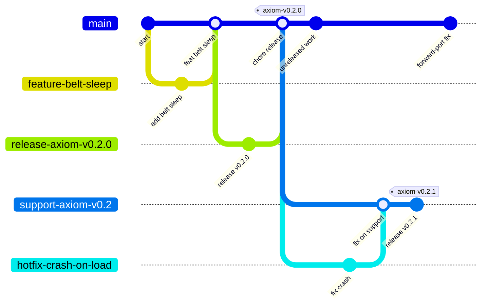

# Branching strategy

This repository uses trunk-based development: GitHub flow plus support branches. `main` is the
trunk. Every change reaches it through a short-lived branch and a squash-merged pull request.
Releases are per-project tags on `main`. The decision is recorded in
[ADR 0006](adr/0006-per-project-release-tags.md).

## Why not classic git-flow

Git-flow adds a long-lived `develop` branch and promotes it into `main` for each release. That does
not fit this repository:

- **Squash-only merges.** A `develop` to `main` promotion either squashes many pull requests into one
  commit, or needs a merge commit. The first loses history and breaks the per-PR changelog and
  `commit-lint`. The second breaks linear history.
- **Double cost.** A second integration branch doubles the CI runs and the merge conflicts.
- **`main` is already releasable.** Every commit on `main` has passed every required check. There is
  nothing left for `develop` to protect.
- **Releases are tags, not merges.** Each project ships by tagging a commit, see
  [versioning.md](versioning.md). No branch merge marks a release.

The model keeps the useful parts of git-flow: release preparation branches, and support branches
for hotfixes to a released line.

## Branches

| Branch | Pattern | Lifetime | Created by | Merges into |
|---|---|---|---|---|
| Trunk | `main` | Permanent | - | - |
| Work | `<type>/<short-name>` | Days | Anyone, with `make branch TYPE=feature NAME=x` | `main`, by squash PR |
| Hotfix work | `hotfix/<short-name>` | Hours | `make hotfix-start` | `support/<project>-vX.Y` by squash PR, then forward-port to `main` |
| Release prep | `release/<project>-vX.Y.Z` | Hours to a day (24-hour cooling-off) | `make release-prepare` | `main` (or the support branch), by squash PR |
| Support | `support/<project>-vX.Y` | While that minor line gets patches | `make hotfix-start` (from the tag, owner) | Never merged. Tags are cut on it. |
| Automated | `dependabot/**`, `revert-<n>-<branch>`, `claude/**` | Days | Bots | `main` |

The work types are `feature`, `fix`, `chore`, `docs`, `ci`, `build`, `perf`, `refactor`, and `test`.
They match the commit types in [commit-conventions.md](commit-conventions.md), except that a branch
says `feature` where a commit says `feat`.

The automated branches come from Dependabot, from the GitHub "Revert" button, and from Claude Code
cloud sessions.

## Naming rules

- Lowercase only. Characters `a-z`, `0-9`, `.`, `_`, and `-`.
- Segments are separated by `/`. The first segment is the type from the table above.
- The short name says what changes, for example `feature/belt-sleep` or `fix/reset-win-line`.

CI job `branch-name` enforces these rules with `scripts/ci/check-branch-name.sh`. Run the same check
locally with `make branch-check`.

## Lifecycle of a work branch

1. **Create.** `make branch TYPE=feature NAME=belt-sleep`. It fetches, then creates
   `feature/belt-sleep` from `origin/main` with no upstream.
2. **Work.** Commit in small steps. Keep the pull request under about 400 changed lines.
3. **Open a pull request** into `main`. Fill in the template. The title is the future commit
   subject, so it follows [commit-conventions.md](commit-conventions.md).
4. **Queue auto-merge.** Turn on auto-merge (squash). The pull request merges the moment every
   required check is green and the branch is up to date.
5. **Cleanup.** GitHub deletes the head branch after the merge. Delete the local branch with
   `git switch main && git pull --ff-only && git branch -d feature/belt-sleep`.

## Release prep branches

`make release-prepare PROJECT=axiom VERSION=0.2.0` creates `release/axiom-v0.2.0`. The branch holds one
signed commit, `chore(axiom): release v0.2.0`, with the version bump and the changelog section.
`make release-pr` pushes it and opens the pull request. It stays open for at least 24 hours, then
squash merges like any other branch. The tag is cut on `main` after the merge. The full runbook is in
[release-process.md](release-process.md).

## Support and hotfix branches

A support branch exists only when a released line needs a patch and `main` already holds unreleased
work for that project. If `main` has no unreleased work for the project, fix on `main` and cut a
patch normally.

1. `make hotfix-start PROJECT=axiom FROM=0.2.0 NAME=crash-on-load` creates `support/axiom-v0.2` from
   tag `axiom-v0.2.0`, if it is missing, and pushes it. Then it creates `hotfix/crash-on-load` from it.
2. Fix on `hotfix/crash-on-load`. Open a pull request into `support/axiom-v0.2`.
3. Prepare the patch release with `BASE=origin/support/axiom-v0.2`, and open that pull request into the
   support branch.
4. Tag the patch on the support branch.
5. **Forward-port.** Open a normal pull request that applies the same fix to `main`, with a `fix(...)`
   subject and a changelog entry under `[Unreleased]`. A fix that ships on a support branch and not on
   `main` comes back in the next minor release.

A support branch is never merged and never deleted while its line gets patches.

## Diagram

The diagram shows one feature branch, one release prep branch, a tag, and a hotfix on a support
branch. Mermaid's `gitGraph` does not accept `/` in a branch name in older versions, so the diagram
writes `feature-belt-sleep` for `feature/belt-sleep`, and so on. It also draws each squash merge as a
merge. On GitHub every one of them is a single squash commit.

## Protection on `main` and `support/**`

The same rules apply to both. They are set by rulesets, see
[branch-protection.md](branch-protection.md).

- Changed only by a squash-merged pull request.
- Every required check green, and the branch up to date with its base.
- Conversations resolved.
- Signed commits required. GitHub signs the squash commit, so a merge from the UI or by auto-merge
  always meets this rule.
- Linear history. No force-push. No deletion.
- No bypass actors. The rules bind admins too.

## Tags

Release tags are `<project>-vMAJOR.MINOR.PATCH[-prerelease]`, for example `axiom-v0.2.0` or
`tictactoe-v0.1.0`. The legacy tag `v0.1.2` stays. Only the owner creates a tag, with
`make release-tag`, and nobody can move or delete one. See [versioning.md](versioning.md) and
[tag-protection.md](tag-protection.md).

## When the team grows

The rules above fit one owner working with Claude. Switch these on as the team grows:

1. **Second maintainer.** In `.github/rulesets/main.json` and `.github/rulesets/support.json`, set
   `required_approving_review_count` to 1, `require_code_owner_review` to true, and
   `require_last_push_approval` to true. Re-apply with `make github-protect`. Turn on "Prevent
   self-review" in the `production` environment.
2. **Split code owners.** Give `.github/CODEOWNERS` one entry per area: `projects/axiom/`,
   `projects/tictactoe/`, `.github/` with `scripts/`, and `docs/`.
3. **Merge queue.** Turn it on when several pull requests merge in the same hour. Add the
   `merge_group` trigger to `ci.yml` first, or the queue waits for checks that never run.
4. **Agents follow the same rules.** Claude works on a branch and opens a pull request. It never
   pushes a tag, and never merges its own pull request without the owner. The rules are in
   `CLAUDE.md`.
