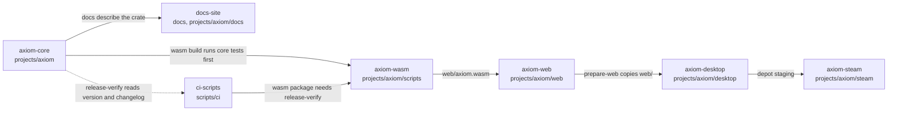
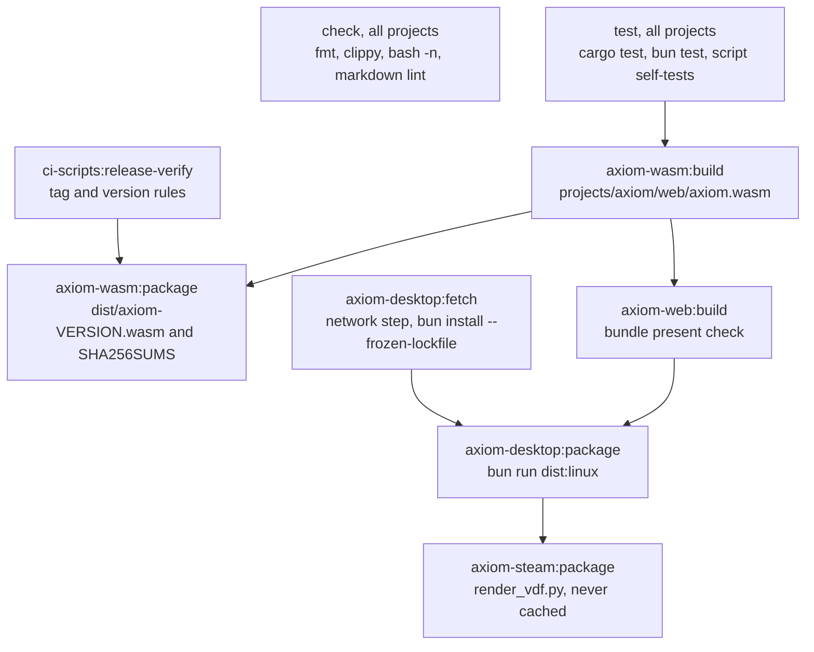

# Build graph

This page shows the project graph and the task pipeline that the moon workspace declares. The
definitions are in `.moon/workspace.yml` and `orchestration/projects/<id>/moon.yml`. The decision
is in [ADR 0003](adr/0003-monorepo-orchestration.md). An arrow `A --> B` means B depends on A.

## Project graph

## Edges and the files that prove them

Each edge is checked against a real file. If the file stops doing what this table says, update the
edge in the `moon.yml` and in this table together.

| Edge | Declared in | Evidence in the repository |
|---|---|---|
| axiom-core to axiom-wasm | `orchestration/projects/axiom-wasm/moon.yml`: `dependsOn`, and `build` depends on `axiom-core:test` | `projects/axiom/scripts/build-wasm.sh` compiles the crate in `projects/axiom/src` |
| axiom-wasm to axiom-web | `orchestration/projects/axiom-web/moon.yml`: `build` depends on `axiom-wasm:build` | `projects/axiom/web/main.js` fetches `./axiom.wasm`. `build-wasm.sh` writes `projects/axiom/web/axiom.wasm` |
| axiom-web to axiom-desktop | `orchestration/projects/axiom-desktop/moon.yml`: `package` depends on `axiom-web:build` | `projects/axiom/desktop/scripts/prepare-web.mjs` copies `../web` and fails without `axiom.wasm` |
| axiom-desktop to axiom-steam | `orchestration/projects/axiom-steam/moon.yml`: `package` depends on `axiom-desktop:package` | `projects/axiom/desktop/scripts/stage-depot.mjs` builds the depot folders that `projects/axiom/steam/render_vdf.py` describes |
| axiom-core to docs-site | `orchestration/projects/docs-site/moon.yml`: `dependsOn`, and the crate source as a task input | `docs/engineering/engineering-principles.md` names `projects/axiom/src/simulation`. The diagram check that uses this edge does not exist yet |
| axiom-core to ci-scripts | `orchestration/projects/ci-scripts/moon.yml`: `dependsOn` | `scripts/ci/check-release-tag.sh` reads `projects/axiom/Cargo.toml` and `projects/axiom/CHANGELOG.md` |
| ci-scripts to axiom-wasm | `orchestration/projects/axiom-wasm/moon.yml`: `package` depends on `ci-scripts:release-verify` | `.github/workflows/release.yml`, job `verify`, runs the same tag check before any build |

The order inside a project is also declared. For example, `axiom-desktop:package` depends on
`axiom-desktop:fetch`, the only task that downloads dependencies, and on `axiom-web:build`.

## Task pipeline for a release

Tasks run in the order of their arrows. Tasks with no arrow between them can run in parallel. The
`publish` step is not in this graph. It stays in `.github/workflows/release.yml`, behind the
`production` approval.

## Caching rules

- A task's cache key is its inputs, its command and its pinned tools. A change outside the inputs
  does not invalidate the cache, so every input list must name every file the command reads.
- `axiom-desktop:fetch` is never cached. Its output lives outside the declared outputs.
- `axiom-steam:package` is never cached. Its output depends on environment values that are not
  inputs.
- Tag builds must bypass the cache, so a release artifact is always built from the tagged source and
  checked by `release-verify` first. This is policy until the CI wiring in ADR 0003, phase 4, is done.
