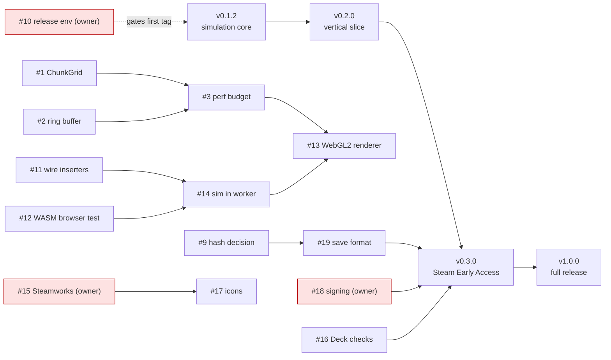

# Roadmap

Project Axiom (`projects/axiom`) roadmap. Each milestone lists its open issues. Labels, status, and
blocked items are on each issue. Milestones have no due dates yet. A date is set only when the owner
can stand behind it.

Status of the code is in [projects/axiom/docs/ARCHITECTURE.md](../projects/axiom/docs/ARCHITECTURE.md).
Quality gates are in [engineering/quality-gates.md](engineering/quality-gates.md).

## Milestones

| Milestone | Goal | Status |
|---|---|---|
| [v0.1.2](https://github.com/olakra/squirrel/milestone/1) | Deterministic simulation core, browser item feed, tic-tac-toe web game | Release PR open; tag pending owner. Six issues open, see [release notes](releases/v0.1.2.md) |
| [v0.2.0](https://github.com/olakra/squirrel/milestone/2) | Playable vertical slice: rendering and inserters wired to the world | Not started |
| [v0.3.0](https://github.com/olakra/squirrel/milestone/3) | Steam Early Access build: desktop shell, Steam depots, Deck-verified checklist items | Not started |
| [v1.0.0](https://github.com/olakra/squirrel/milestone/4) | Full release | Scope not defined |

## v0.1.2: deterministic simulation core

Done in code: belt lane and chain, fixed-timestep world, state hash, 1,000-tick determinism test.

| Issue | Item | Type | Status |
|---|---|---|---|
| [#1](https://github.com/olakra/squirrel/issues/1) | Integrate ChunkGrid into World so only active chunks tick | Feature | ready |
| [#2](https://github.com/olakra/squirrel/issues/2) | Replace O(N) rear insertion with ring-buffer lanes | Feature | ready |
| [#3](https://github.com/olakra/squirrel/issues/3) | Record a 60 Hz budget and baseline for the stress benchmark | Feature | ready |
| [#4](https://github.com/olakra/squirrel/issues/4) | Decide the benchmark regression gate (ADR) | Task | ready |
| [#5](https://github.com/olakra/squirrel/issues/5) | Verify cargo-deny and llvm-cov gates pass in CI | Feature | ready |
| [#6](https://github.com/olakra/squirrel/issues/6) | ARCHITECTURE.md status table is stale | Bug | ready |
| [#7](https://github.com/olakra/squirrel/issues/7) | Restore the release runbook that release.yml links to | Bug | ready |
| [#8](https://github.com/olakra/squirrel/issues/8) | Mermaid diagrams for the belt model, tick order, and inserter states | Feature | ready |
| [#9](https://github.com/olakra/squirrel/issues/9) | Decide the state hash: FNV-1a or Blake3 | Task | ready |
| [#10](https://github.com/olakra/squirrel/issues/10) | Owner: production release environment and tag ruleset | Task | **blocked on owner** |

## v0.2.0: playable vertical slice

| Issue | Item | Type | Status |
|---|---|---|---|
| [#11](https://github.com/olakra/squirrel/issues/11) | Wire inserters and splitters into World with a fixed tick order | Feature | ready |
| [#12](https://github.com/olakra/squirrel/issues/12) | Headless browser test for the WASM exports | Feature | ready |
| [#13](https://github.com/olakra/squirrel/issues/13) | Instanced WebGL2 sprite renderer in the worker | Feature | ready |
| [#14](https://github.com/olakra/squirrel/issues/14) | Run the simulation in the Web Worker with the WASM build | Feature | ready |

## v0.3.0: Steam Early Access build

| Issue | Item | Type | Status |
|---|---|---|---|
| [#15](https://github.com/olakra/squirrel/issues/15) | Owner: Steamworks setup (partner account, App ID, depots, upload account) | Task | **blocked on owner** |
| [#16](https://github.com/olakra/squirrel/issues/16) | Deck checklist: controller glyphs and 1280x800 readability in code | Feature | ready |
| [#17](https://github.com/olakra/squirrel/issues/17) | Application icons for the desktop build | Feature | ready |
| [#18](https://github.com/olakra/squirrel/issues/18) | Owner: code signing and notarization | Task | **blocked on owner** |
| [#19](https://github.com/olakra/squirrel/issues/19) | Save format and versioning policy (before any save code) | Feature | ready |
| [#20](https://github.com/olakra/squirrel/issues/20) | Bump Electron to a supported major | Feature | ready |

## v1.0.0: full release

| Issue | Item | Type | Status |
|---|---|---|---|
| [#21](https://github.com/olakra/squirrel/issues/21) | Define the v1.0.0 scope | Feature | ready |

## Dependencies

Red nodes are blocked on the owner. Arrows show what must land first. Milestone arrows are the order of
delivery. Milestones have no dates yet.

## Owner-only work

These cannot be done from the repository. Each issue states the owner steps.

- [#10](https://github.com/olakra/squirrel/issues/10): the `production` environment and tag ruleset (needed before the
  first tag).
- [#15](https://github.com/olakra/squirrel/issues/15): Steamworks partner account, App ID, depots, and upload secrets.
- [#18](https://github.com/olakra/squirrel/issues/18): code-signing certificates for macOS and Windows.

## Process

- Every item is an issue with a template (Bug or Feature, or a Task for owner steps and decisions).
- Labels: `area:*` for the part of the codebase, `priority:p0` to `p3`, `risk:standard`, `risk:normal`, or
  `risk:emergency`, and `status:ready`, `status:in-progress`, or `status:blocked`.
- Benchmarks are a review rule for now (see #4). A change that makes the stress scenario more than 10%
  slower needs a written reason in the PR.
