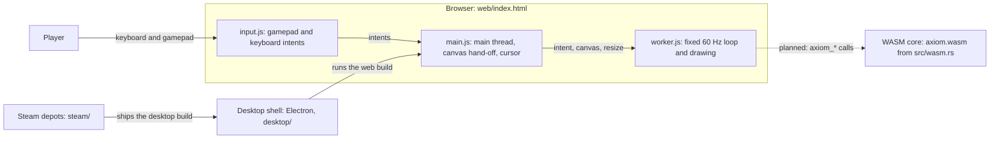
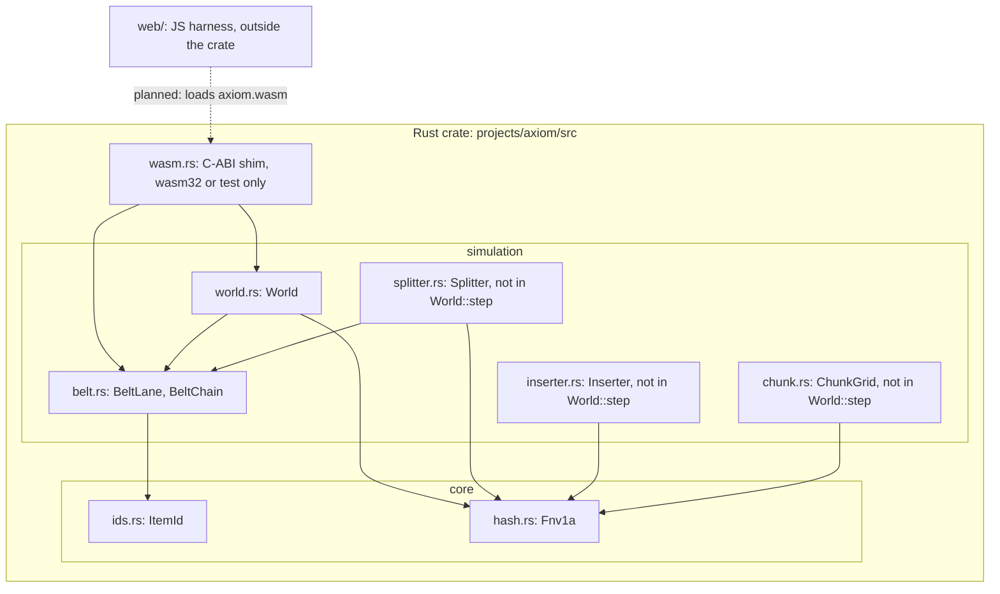
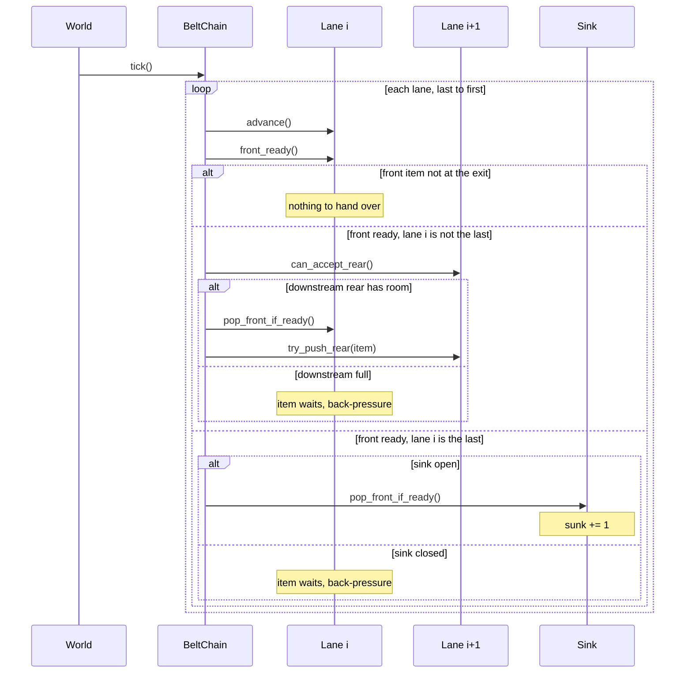
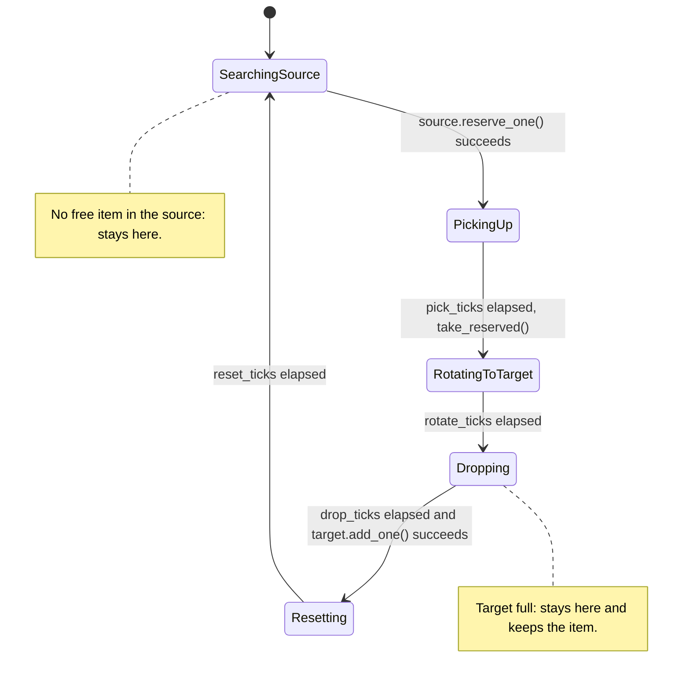
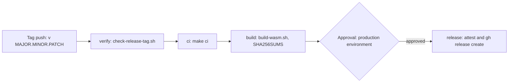

# Diagrams

Each diagram below was drawn from the source named under it. When the code and a diagram disagree, the code wins and the
diagram is wrong. Diagrams are Mermaid text in this page. The browser draws them from a CDN script when the page loads.
If the script cannot load, the Mermaid source stays on the page.

## System context

Who and what touches the game. Solid arrows exist today. The dashed arrow is planned: the worker does not load
`axiom.wasm` yet.

Checked against: `projects/axiom/web/index.html`, `web/main.js`, `web/input.js`, `web/worker.js`,
`projects/axiom/src/wasm.rs`, `projects/axiom/desktop/README.md`, `projects/axiom/steam/README.md`.

## Container view

The Rust crate and its modules. Arrows point from the user to the thing it uses. The crate has no dependency on the web
shell. The dashed arrow is planned.

Checked against: `projects/axiom/src/lib.rs` (module declarations), the `use crate::` lines in `src/simulation/*.rs`,
`src/core/*.rs` and `src/wasm.rs`, and `src/simulation/world.rs` (`World::step` calls only `BeltChain::tick`).

## Belt tick

One call to `World::step` runs `BeltChain::tick` once. The chain walks its lanes from the last lane to the first, so a
lane frees room before its upstream neighbour hands items over. Each lane advances first, then it may hand its front
item
on.

Checked against: `projects/axiom/src/simulation/world.rs` (`World::step`), `projects/axiom/src/simulation/belt.rs`
(`BeltLane::advance`, `front_ready`, `can_accept_rear`, `try_push_rear`, `pop_front_if_ready`, `BeltChain::tick`,
`set_sink_closed`).

## Inserter state machine

Phases come from `Phase` in `projects/axiom/src/simulation/inserter.rs`. The module comment gives the order:
`SearchingSource -> PickingUp -> RotatingToTarget -> Dropping -> Resetting`. Each timed phase lasts its configured tick
count. The state machine is not wired into `World::step` yet.

Checked against: `projects/axiom/src/simulation/inserter.rs` (`Phase`, `Inserter::tick`, `search`, `pick_up`, `rotate`,
`drop_into`, `reset`).

## Release pipeline

The release workflow in `.github/workflows/release.yml` runs on a tag that matches `v*.*.*`. Each job needs the one
before
it. The last job waits for a reviewer in the `production` environment.

Checked against: `.github/workflows/release.yml` (the `needs:` chain, `environment: production`, and the `permissions`
blocks).
